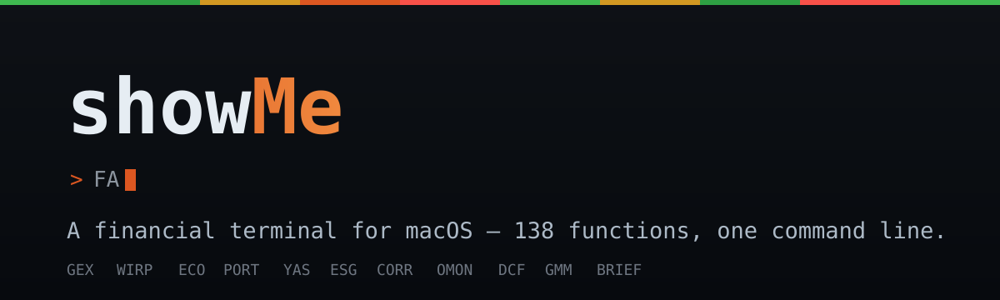
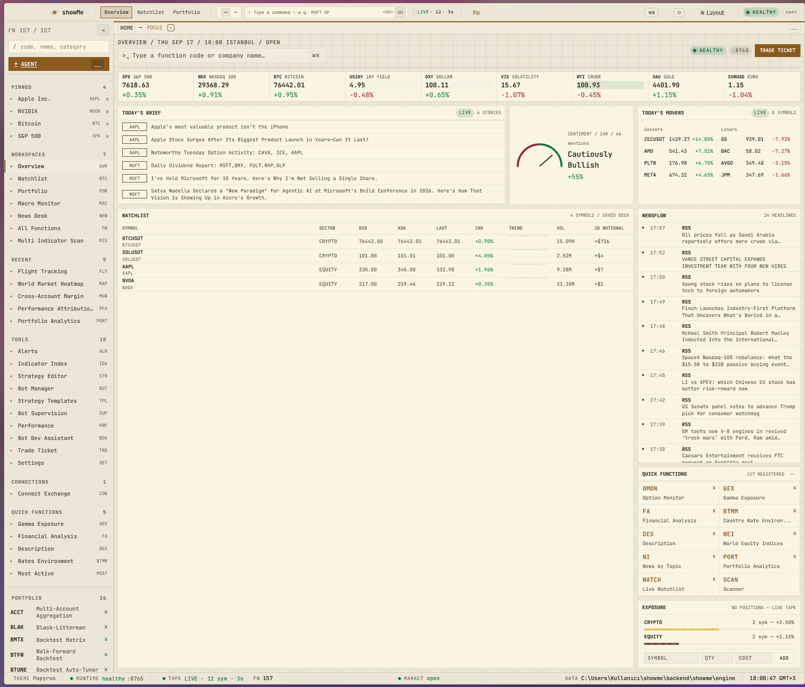
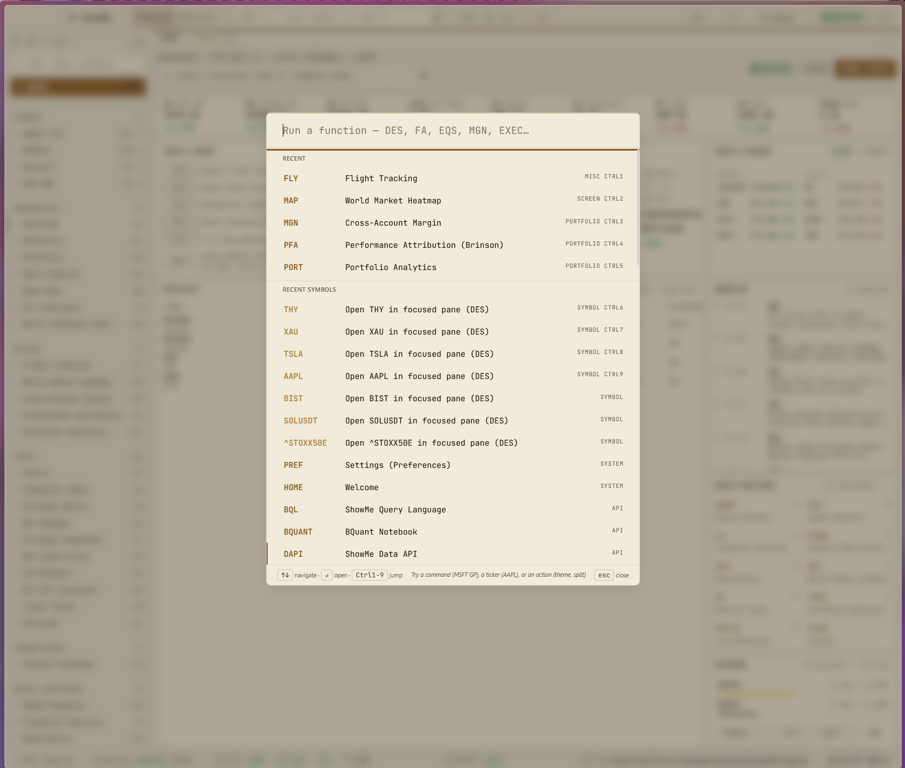
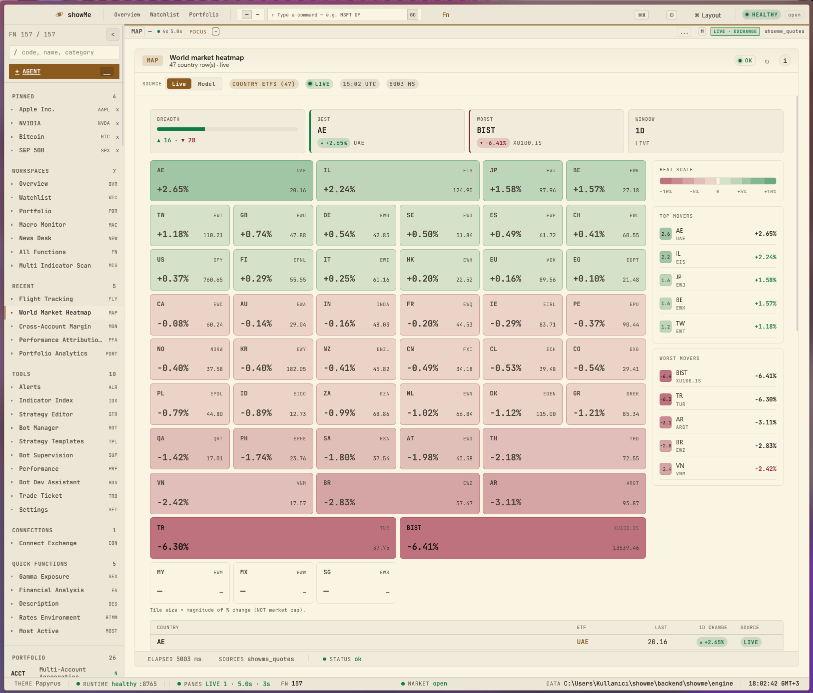
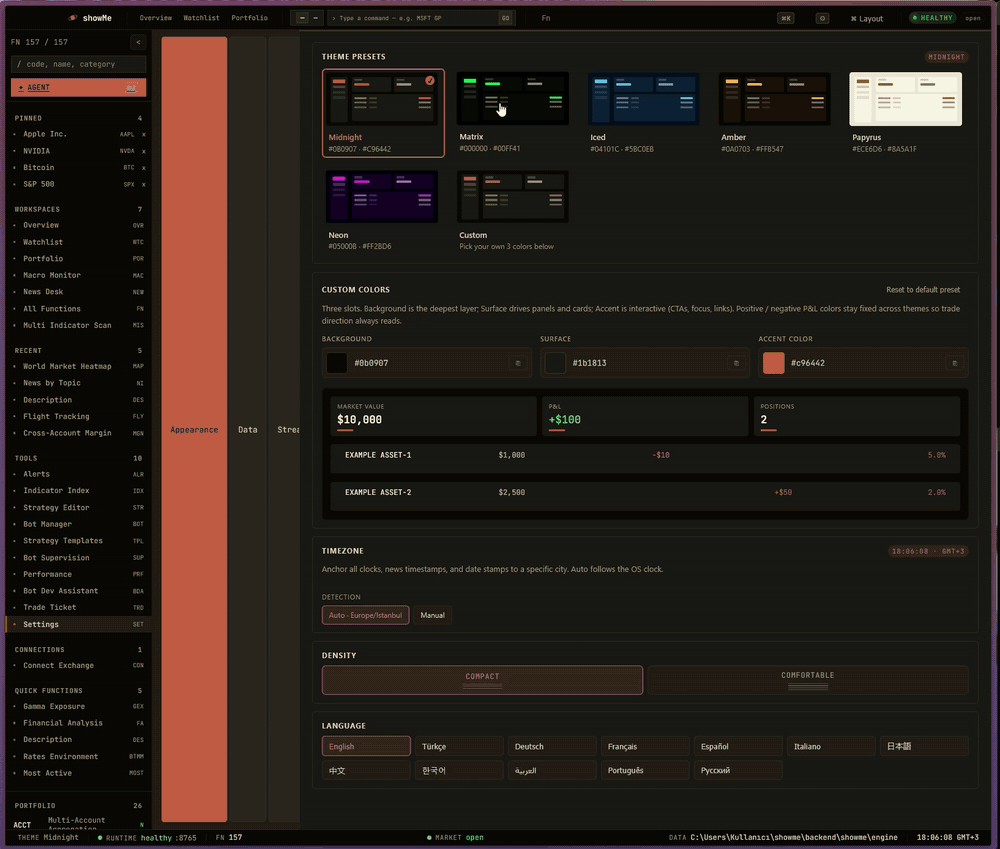
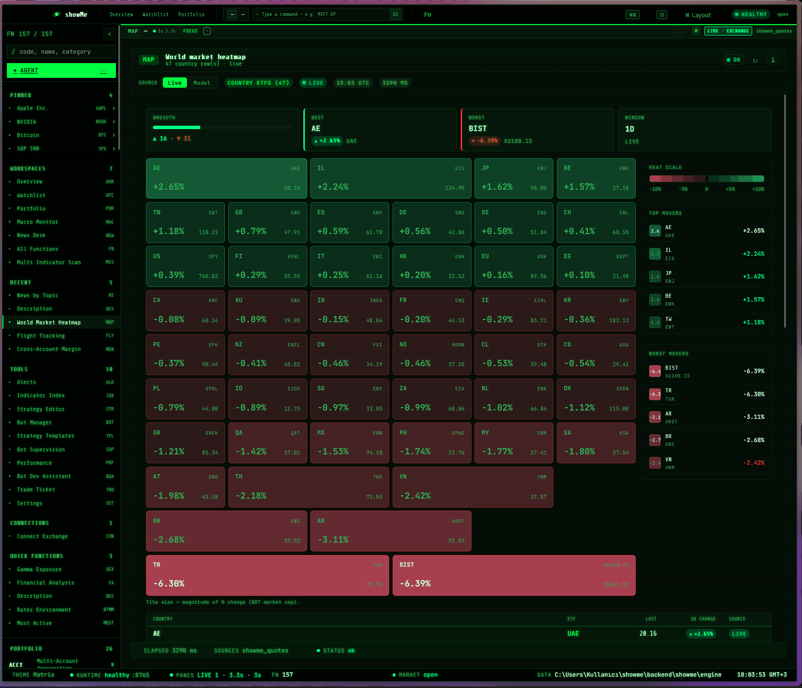
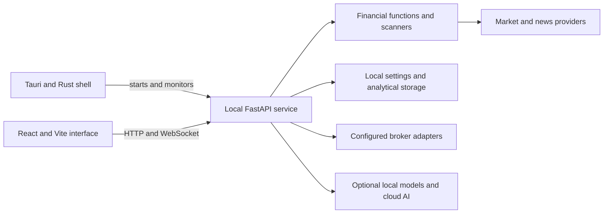

# showMe

<p align="center">
  
</p>

<p align="center">
  <a href="LICENSE"></a>
  
  
  
  
  <a href="https://github.com/nazmiefearmutcu/showMe/releases/latest"></a>
</p>

showMe is a local financial terminal for market research, scanning and portfolio analysis. A command palette opens tools by short function codes, while a Python backend retrieves data and performs the calculations.

The native release workflow targets **macOS on Apple Silicon**. The repository also includes Windows configuration and development scripts; their presence does not establish a tested Windows release.

## What you can do

- Review company financials, valuations, options, rates, economic releases and news.
- Scan markets across multiple timeframes and inspect individual candidates.
- Analyze portfolio exposure, correlations, scenarios and backtests.
- Work with financial charts, market maps, watchlists and saved terminal layouts.
- Configure data providers, optional model features and broker connections.

Representative function codes:

| Code | Tool |
| --- | --- |
| `FA` | Financial statements |
| `DCF` | Discounted cash-flow model |
| `GEX` | Options gamma-exposure analysis |
| `ECO` | Economic calendar |
| `CORR` | Correlation matrix |
| `PORT` | Portfolio analytics |

Available results depend on the selected instrument, provider and configuration. The function catalog can be inspected through the backend's `/api/function-index` endpoint and `npm run audit:functions`.

## Preview

### Market workspace



### Function palette



### World market map



### Appearance





## Architecture



| Component | Responsibility |
| --- | --- |
| `tauri/` | Native window, menus, shortcuts, credentials and backend lifecycle |
| `ui/` | Command palette, function panes, charts, themes and terminal state |
| `backend/showme/` | API, financial engine, scanners, providers and integrations |
| `packaging/` | Python sidecar packaging and native release scripts |

The shell starts the Python sidecar on a loopback port and discovers that port from its startup output. A per-session token authenticates native UI requests. The backend runs calculations and maintains local state; provider requests, cloud AI calls and configured broker operations communicate with external services.

## Data and connections

Adapters include **Binance, yfinance, FRED, SEC EDGAR, GDELT, OpenFIGI, TreasuryDirect and RSS**. Some sources need credentials, have delayed coverage or impose rate and regional limits. Function contracts can report unavailable providers; a blank result can reflect missing source data rather than a calculation failure. Valuation models, Greeks and forecasts are calculated estimates.

The broker layer includes local paper trading, Alpaca paper trading and credential-based CCXT exchange adapters. Execution behavior depends on the configured connection and its permissions. Review the selected account and environment before using an execution function.

FinBERT sentiment and Whisper transcription use local model inference and may download weights on first use. Optional cloud LLM features require provider credentials and send requests to the selected service. Resource needs vary substantially by model.

## Get started

Download available native builds from [Releases](https://github.com/nazmiefearmutcu/showMe/releases). The automated release configuration packages Apple Silicon macOS builds.

For source development, install **Node.js 24**, **Python 3.11+**, **uv**, a **Rust toolchain** and the native build tools required by Tauri. On macOS, install the Xcode command-line tools.

```bash
git clone https://github.com/nazmiefearmutcu/showMe.git
cd showMe
npm ci
cd backend
uv sync --all-extras
cd ..
npm run tauri:dev
```

The native launcher looks for the backend virtual environment. `SHOWME_PYTHON` can select another Python interpreter with the backend installed.

For browser development, use two terminals from the repository root:

```bash
# Terminal 1
cd backend
uv run python -m showme.server --host 127.0.0.1 --port 8765
```

```bash
# Terminal 2
npm run dev
```

The browser interface runs at `http://localhost:5173`. Native-only features require the Tauri application.

## Development and packaging

```bash
# From the repository root
npm run test:backend
npm --workspace ui run test
npm run lint
npm run lint:py
```

Build the macOS sidecar and bundle with:

```bash
bash packaging/build_sidecar.sh
npm run tauri:build
```

Signing, notarization and updater publishing require the corresponding credentials and release configuration. See [Contributing](CONTRIBUTING.md) and [Security](SECURITY.md) for project guidance.

## License

[MIT](LICENSE). Financial outputs are research tools and estimates, provided without investment advice or a guarantee of accuracy.

Created By Aylin (Nazmi Efe Armutcu)
